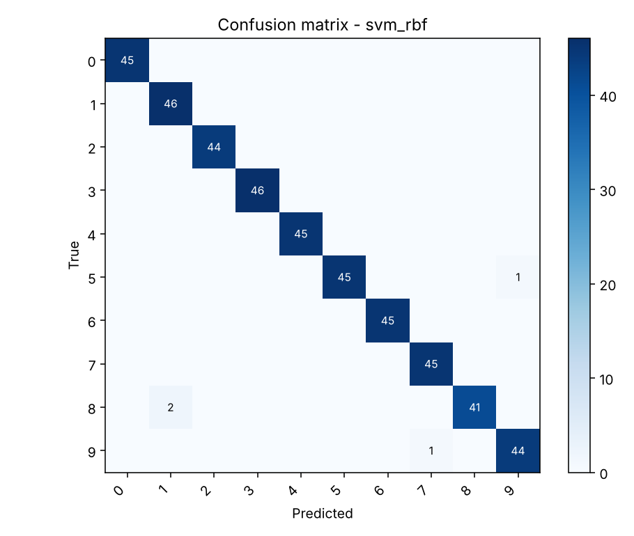
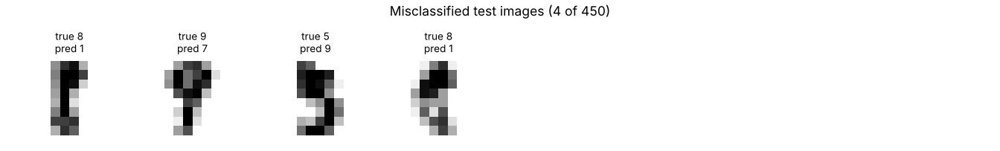
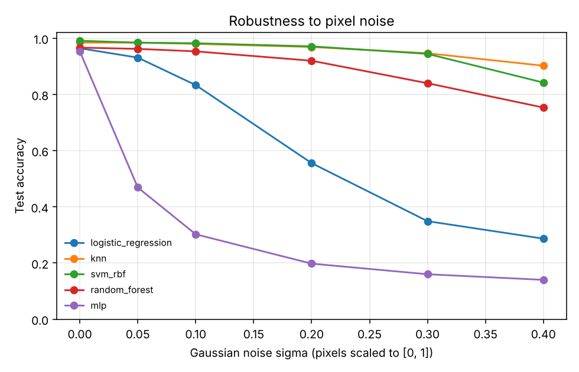

# Image Recognition with scikit-learn

[](https://github.com/JamieCrock/image-recognition-sklearn/actions/workflows/ci.yml)


This project builds a reproducible pipeline for **tuning, comparing and stress-testing classical image classifiers**. It takes the topic of my scikit-learn image-recognition coursework (*Big Data and Machine Learning*, Swansea University) and turns it into a standalone project.

Five model families are tuned with cross-validated grid search and scored once on a held-out test set. They are then pushed further with data augmentation, a pixel-noise robustness test and an ablation of a preprocessing step that turned out to matter a great deal.

**Headline: 99.11% test accuracy** (SVM, RBF kernel) on handwritten digits, rising to **99.56%** with shift augmentation.

## Results

Dataset: scikit-learn `digits`, which has 1,797 greyscale 8×8 images in 10 classes. It is split 75/25 with stratification. Hyperparameters are chosen by 5-fold stratified CV on the training set only, so the test set is used exactly once. Seed 42.

| Model | CV accuracy | Test accuracy | Macro F1 |
|---|---|---|---|
| **SVM (RBF) + PCA** | **99.26%** | **99.11%** | **0.991** |
| k-NN + PCA | 98.81% | 98.44% | 0.984 |
| Random forest | 97.85% | 96.67% | 0.966 |
| Logistic regression | 96.73% | 96.44% | 0.964 |
| MLP (1 hidden layer) | 96.81% | 95.33% | 0.953 |

The best model made 4 errors in 450 test images: two 8s read as 1s, a 9 read as a 7 and a 5 read as a 9.

| Confusion matrix | Misclassified images |
|---|---|
|  |  |

**Augmentation:** adding copies of every training image shifted by one pixel up, down, left and right (1,347 → 6,735 images) raised the SVM's test accuracy from **99.11% to 99.56%**.

### Finding: standardising pixels destroys noise robustness

An early version of the pipeline standardised every pixel with `StandardScaler`, the default in most scikit-learn tutorials. Clean accuracy looked fine, but adding a little Gaussian noise to the test images (σ = 0.05) dropped the SVM's accuracy from **97.8% to 23.6%**.

The cause was the border pixels of the 8×8 digits, which are almost always 0. Their standard deviation is near zero (11 of the 64 pixels have σ < 0.02), so standardising divides any noise in those pixels by a tiny number and blows it up into huge feature values. Pixels already share a [0, 1] range, so they don't need standardising.

Once scaling became a tuned hyperparameter, cross-validation chose raw pixels for the SVM and k-NN. The ablation below refits each tuned model both ways (test accuracy, noise σ = 0.1):

| Model | Clean, standardised | **Noisy, standardised** | Clean, raw pixels | **Noisy, raw pixels** |
|---|---|---|---|---|
| SVM (RBF) | 98.2% | **13.6%** | 99.1% | **98.2%** |
| k-NN | 96.9% | **33.3%** | 98.4% | **98.0%** |
| Logistic regression | 96.4% | **83.3%** | 96.7% | **95.8%** |
| MLP | 95.3% | **30.2%** | 94.9% | **95.3%** |

On clean data, cross-validation still slightly prefers standardisation for logistic regression and the MLP. That is exactly why these models degrade under noise in the robustness curve below, and it is a good reminder that **CV accuracy on clean data says nothing about robustness**.



You can find all outputs in [`results/digits/`](results/digits): [`summary.md`](results/digits/summary.md), `model_comparison.csv`, `robustness.csv`, `scaling_ablation.csv`, `metrics.json` (per-class precision, recall and F1) and the figures.

## Quick start

```bash
git clone https://github.com/JamieCrock/image-recognition-sklearn.git
cd image-recognition-sklearn
python -m venv .venv && source .venv/bin/activate
make install
make run          # full experiment on digits (about a minute, no download)
```

Larger datasets are fetched from OpenML and cached on first use:

```bash
imgrec --dataset mnist --max-samples 20000 --quick
imgrec --dataset fashion-mnist --max-samples 20000 --quick
```

Options: `--models svm_rbf knn` to run a subset, `--quick` for small grids and 3-fold CV, `--no-figures`, `--seed`.

## How it works

| Stage | Details |
|---|---|
| Data (`data.py`) | Pixels are scaled to [0, 1] and split with stratification. Augmentation uses ±1-pixel shifts (with optional random rotation). Gaussian noise is seeded and clipped. |
| Models (`models.py`) | Each model is a `Pipeline` (optional `StandardScaler` → optional `PCA` → classifier), so all preprocessing is fitted inside each CV fold with no leakage. |
| Selection (`experiment.py`) | `GridSearchCV` with `StratifiedKFold(5)`. The grids cover regularisation, kernel width, PCA dimensionality, neighbour count and weighting, tree count and depth, network width and weight decay, and whether to standardise. |
| Evaluation | Accuracy, macro precision, recall and F1, a per-class report, a confusion matrix, fit times, noise robustness and the scaling ablation. |
| Figures (`plots.py`) | Sample grid, confusion matrix, misclassified examples, robustness curves and PCA explained variance. |

```
src/imgrec/
├── data.py         # loading, augmentation, noise
├── models.py       # pipelines + hyperparameter grids
├── experiment.py   # tuning, evaluation, augmentation, robustness, ablation
├── plots.py        # figures
└── cli.py          # `imgrec` command
tests/              # pytest: data, augmentation, grids, end-to-end runs, CLI
```

## Testing

```bash
make test   # pytest + coverage
make lint   # ruff
```

CI runs the linter, the tests and a quick end-to-end experiment on Python 3.11–3.13.
